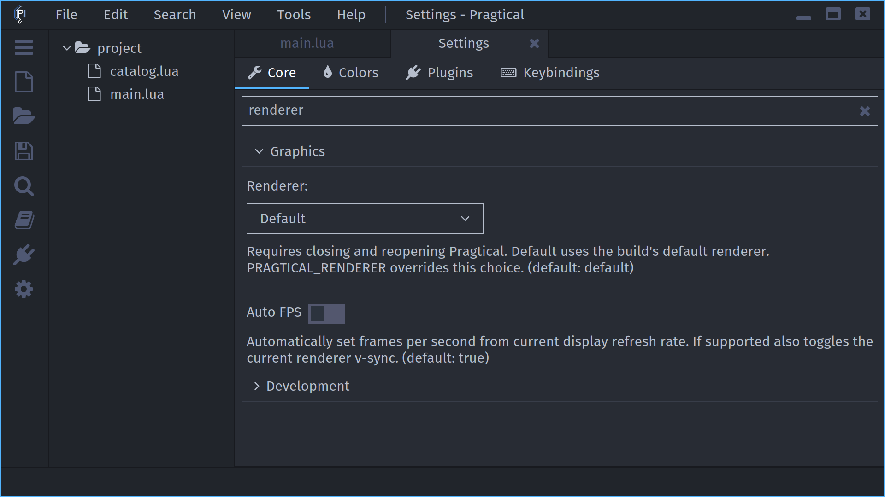
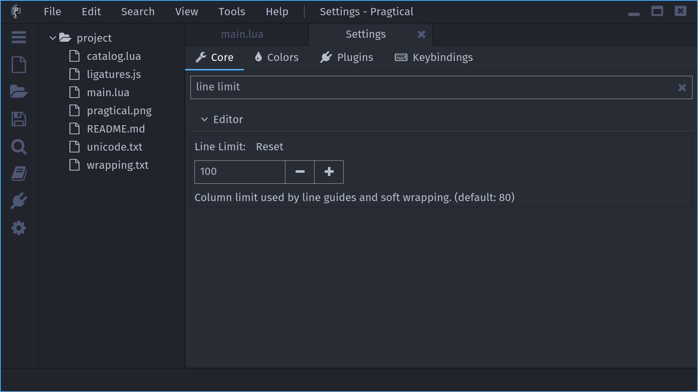
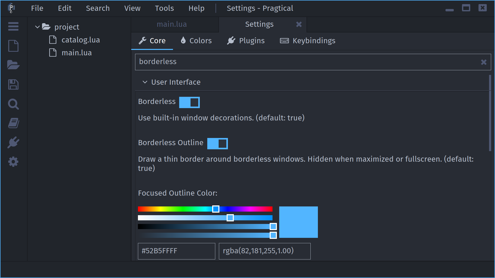

import Tabs from '@theme/Tabs';
import TabItem from '@theme/TabItem';

# Configuration

## Location

Pragtical searches a list of paths to store user configuration.
This path is also known as `USERDIR`.
The first path that is available will be used.

1. `<path_to_pragtical_executable>/user`
2. `$PRAGTICAL_USERDIR`
3. `$XDG_CONFIG_HOME/pragtical`
4. `$HOME/.config/pragtical`

On Windows, `$HOME` will be replaced with `$USERPROFILE`.

## User Module

Pragtical is mainly configured through the user module.
The user module is a Lua script run by Pragtical during startup,
before plugins are loaded.
Thus, you can change configuration options, bind shortcut keys, load color
schemes, change the fonts among other things.

To modify the user module, you can run the command `core:open-user-module`.
You can also modify the file `USERDIR/init.lua` directly.
Pragtical will reload the file on file change.

## Project Module

The project module is an optional module which is loaded from the current
project's directory when Pragtical is started. Project modules can be useful for
things like adding custom commands for project-specific build systems, or
loading project-specific plugins.

The project module is loaded when the editor starts,
after the user module is loaded but before plugins are loaded.

To modify project module, you can run the command `core:open-project-module`.
The command will create a project module if it does not exist.

## Settings GUI

The settings plugin provides a GUI to configure Pragtical.

![Settings User Interface][14]

Open it from **Tools > Settings**, the toolbar, or the `ui:settings` command.
Changes apply immediately and are saved in `USERDIR/user_settings.lua`.
That file holds GUI overrides; keep hand-written configuration in your user
module. An explicit GUI value takes precedence over the corresponding user
module setting.

### Search Settings

The **Core**, **Colors**, **Plugins**, and **Keybindings** tabs each have a
search field. Core and Plugins match all the words you enter against setting
names, descriptions, paths, and section names. For example, search for
`system fallback`, `line limit`, or `renderer` instead of opening every section.
The Plugins search also filters the Installed plugin list.



Clear the field with its **X** button to return to the previous section
expansion state. Searching does not change any setting.

### Reset an Option

A **Reset** button appears beside an option when a GUI override has been
saved. Reset removes that override and reapplies the option's default or
configured default provider. The button disappears after resetting. This also
works for fonts, colors, lists, and optional values; it does not require
resetting an entire section or deleting your configuration file.



## Fonts

Pragtical comes with JetBrains Mono and Fira Sans by default.

You can also enable [font ligatures](font-ligatures.md) and add
[color emoji](color-emoji.md). These guides include Settings UI instructions
and Lua examples.

To change the fonts used by the editor, you can change the
variable `style.font` and `style.code_font`.
These variables are responsible for the UI font and code
font respectively.

To load a font, you can use `renderer.font.load()`.
This function allows you to load a font file as long as
it is supported by FreeType.
The function takes in the path to the font file and
the pixel size of the font.

### Automatic Font Fallback

Missing characters are looked up in fonts installed on your operating system
by default. This includes other writing systems and color emoji when a
suitable font is installed. Windows uses DirectWrite, macOS uses CoreText,
and Linux uses Fontconfig when available. A font still needs to contain the
characters or complete sequence being displayed.

The Font Selector's **System Fallback** checkbox controls this behavior.
In Lua, pass `{ system_fallback = false }` to `renderer.font.load()` to use only
your configured fonts. In a font group, the first font controls this option.

Explicit fallback fonts remain useful when you want a particular appearance
or want to bundle a font without installing it system-wide. Use
`renderer.font.group()` with separately loaded fonts, in priority order;
automatic system fallbacks are considered after the explicit group.

<Tabs groupId="configuration">
  <TabItem value="user-module" label="User Module" default>

For this example, we'll load Noto Sans Mono, which is
located in `/usr/share/fonts/noto/NotoSansMono-Regular.ttf`
and set it as our code font.

```lua
local style = require "core.style"
-- SCALE is the pixel scaling required for the current DPI setup.
-- Font sizes are in pixels; SCALE follows the interface scale.
style.code_font = renderer.font.load("/usr/share/fonts/noto/NotoSansMono-Regular.ttf", 15 * SCALE)
```

Next, we'll also load Noto Sans Mono CJK SC, which is located
in `/usr/share/fonts/noto-cjk/NotoSansCJK-Regular.ttc` and use
it as fallback.

```lua
local style = require "core.style"
-- do not ever do style.code_font = { style.code_font, ... }
-- style.code_font can be a font group and pragtical does not
-- support nested font groups!
style.code_font = renderer.font.group {
  renderer.font.load("/usr/share/fonts/noto/NotoSansMono-Regular.ttf", 15 * SCALE),
  renderer.font.load("/usr/share/fonts/noto-cjk/NotoSansCJK-Regular.ttc", 15 * SCALE)
}
```

:::note Font collections
Explicit file loading uses the default face of a font collection. Automatic
system fallback can resolve the appropriate face inside an installed collection.
:::

  </TabItem>
  <TabItem value="settings-ui" label="Settings UI">

To change the code font, navigate to the "Core" tab
and expand the "Editor" section.
The first entry should be a list of code fonts used by the editor.
![The fonts option under the Editor section][1]

To add a new font, click the "Add" button.
A font selector will be shown.
![Font selector][2]

To choose a font, press the "Mono" button and select a font from
the list. The "All" button allows you to select non-monospace
fonts.

A demo text will be shown at the textbox
on the top of the selector.
To change the antialiasing settings of the font, click on the
dropdown to the left.
To change the hinting settings of the font, click on the dropdown
to the right.
The changes will be reflected automatically on the preview window.
Press "Save" to add the font or "Cancel" to go back.

Moving through the font picker's results also previews the highlighted font.
Confirming chooses it; cancelling returns to the font that was selected before
opening the picker.

To edit an existing font, double-click its entry in the list.
The **Ligatures** checkbox enables optional programming ligatures for fonts
that support them. **System Fallback** enables installed-font discovery.
Combining characters and supported emoji sequences are shaped independently
of the programming-ligature setting.
The size and font options in this dialog apply to all fonts in the list.

If you have more than one fonts set up, you can change
the fallback order by pressing the "‹" and "›" buttons.
![The buttons to change font ordering][3]

  </TabItem>
</Tabs>

## Keyboard shortcuts

Keyboard shortcuts are managed by the `core.keymap` module.
This module maps keyboard shortcuts to one or more commands,
where each command has a predicate that determine whether
it should run based on certain conditions.

For a list of default keyboard shortcuts, check out these pages:

- [non-macOS platforms (Windows, Linux, etc.)][4]
- [macOS][5]

### Adding a keyboard shortcut

To add keyboard shortcuts, you can use `keymap.add()`.

<Tabs groupId="configuration">
  <TabItem value="user-module" label="User Module" default>

For example, bind <kbd>ctrl+m</kbd> to move to the previous character:

```lua
local keymap = require "core.keymap"
keymap.add {
  ["ctrl+m"] = "doc:move-to-previous-char"
}
```

When a shortcut names several commands, Pragtical tries their predicates in
order and runs the first eligible command. It does not run every command as
a sequence. To perform several actions, register a command that calls those
actions and bind that command instead.

Alternatively, to override a keyboard shortcut completely,
pass `true` as the second parameter of `keymap.add()`.

```lua
local keymap = require "core.keymap"
keymap.add {
  ["ctrl+m"] = "doc:move-to-previous-char"
}
keymap.add({
  ["ctrl+m"] = "doc:move-to-previous-line"
}, true)
```

This will cause Pragtical to only run
`doc:move-to-previous-line` when <kbd>ctrl+m</kbd> is pressed.

  </TabItem>
  <TabItem value="settings-ui" label="Settings UI">

Navigate to the "Keybindings" tab.
![The keybindings tab][6]

Scroll until you find the entry containing
the command you want to bind to and click on it.
In recent versions of the Settings plugin, you can also
search for commands with the text box on top.
In this example, we'll pick `doc:move-to-previous-char`.

To add a keybind, press the "Add" and press the key combination
that you want to bind to. Afterwards, press "Save".
![The dialog to assign keyboard shortcuts][7]


If the keyboard shortcut is set properly,
you will see the updated keyboard shortcut
on the "Bindings" section at the right.
![The keybind tab with changed keybinds][8]

To replace previous keyboard shortcuts,
simply delete any existing keyboard shortcut
via the "Remove" button, then re-add it.

  </TabItem>
</Tabs>

### Removing a keyboard shortcut

To remove an existing keyboard shortcut, you can use
`keymap.unbind()`.

<Tabs groupId="configuration">
  <TabItem value="user-module" label="User Module" default>

In this example, we will unbind <kbd>ctrl+m</kbd>.

```lua
local keymap = require "core.keymap"
keymap.unbind("ctrl+m", "doc:move-to-previous-line")
keymap.unbind("ctrl+m", "doc:move-to-previous-char")
```

This will unbind the two commands from <kbd>ctrl+m</kbd>.

Alternatively, replace the mapping with an empty command list to unbind all
commands from <kbd>ctrl+m</kbd>:

```lua
local keymap = require "core.keymap"
keymap.add({ ["ctrl+m"] = {} }, true)
```

  </TabItem>
  <TabItem value="settings-ui" label="Settings UI">

Navigate to the "Keybindings" tab.
![Screenshot showing the keybindings tab][8]

Scroll until you find the entry containing
the command you want to bind to and click on it.
In recent versions of the Settings plugin, you can also
search for commands with the text box on top.
In this example, we pick `doc:move-to-previous-char`.

To remove a keyboard shortcut, select the shortcut you want to remove
and press the "Remove" button.
Afterwards, press the "Save" button to save the changes.
![Screenshot showing the keybind changer][9]

  </TabItem>
</Tabs>

## Themes

The default theme is a dark theme.
Themes are implemented as plugins that changes the styling
variables of Pragtical.

This can be changed with `core.reload_module()` and loading
the appropriate theme file.

<Tabs groupId="configuration">
  <TabItem value="user-module" label="User Module" default>

To load the theme `summer`, add `core.reload_module "colors.summer"`.

```lua
local core = require "core"
core.reload_module "colors.summer"
```

  </TabItem>
  <TabItem value="settings-ui" label="Settings UI">

Navigate to the "Colors" tab.

![The Colors tab][10]

Select your desired theme.
The colors should apply immediately.

  </TabItem>
</Tabs>

## Other options

There are a lot of configuration options that can be modified.
A list of these options can be found in [`data/core/config.lua`][11],
but we'll list a few common ones here.

### Indentation

To change the indentation size and type, set `config.indent_size`
and `config.tab_type` respectively.

```lua
local config = require "core.config"
config.indent_size = 4 -- set indentation to 4
config.tab_type = "soft" -- "soft" for spaces, "hard" for tabs
```

### Window decoration

Pragtical draws its own title bar by default. The application menu shares that
bar, and restored windows have a thin outline. The outline disappears when
maximized or fullscreen. Disable **Core > User Interface > Borderless** to
use your operating system's decorations instead.



```lua
local config = require "core.config"
config.borderless = true
config.borderless_outline = true
-- Optional: override theme-derived outline colors.
config.outline_focused = { 97, 175, 239, 255 }
config.outline_unfocused = { 92, 99, 112, 255 }
-- Title-bar overlay on focus loss; alpha 0 disables the dimming.
config.borderless_unfocused_overlay = { 0, 0, 0, 64 }
```

### Ignoring files

Pragtical does not index certain files and directories by default, such as
version control and executables.
This can be modified by changing `config.ignore_files`.
This value is a table of Lua patterns.
For directories, the pattern ends with a forward slash (`/`).
For files, the pattern ends with the end anchor (`$`).

```lua
local config = require "core.config"
-- ignore .data/
table.insert(config.ignore_files, "^%.data/")
```

### Caret

You can disable or change the blinking rate of the caret.

```lua
local config = require "core.config"
config.disable_blink = true -- disable caret blinking
config.blink_period = 0.4 -- change caret blink rate
```

### FPS (Frame rate)

**Auto FPS** uses the display's refresh rate when available. Disable it to
use a manual limit. See [Renderer Backends](renderer-backends.md#frame-rate-and-vsync)
for presentation and vsync behavior.

```lua
local config = require "core.config"
-- set FPS to 30
config.auto_fps = false
config.fps = 30
```

### Transitions

You can disable any animations/transitions by setting `config.transitions`
to `false`.
To disable individual transitions, you can set any member of
`config.disabled_transitions` to `true`.

```lua
local config = require "core.config"
-- disable all transitions
config.transitions = false
-- disable commandview and scroll transitions
config.disabled_transitions = {
  commandview = true,
  scroll = true
}
```

To change the animation rate, set `config.animation_rate`.

```lua
local config = require "core.config"
-- slow down the animations to half speed
config.animation_rate = 0.5
```

### Other options

:::note A quick reference of other options.
| Options                   | Value Type                    | Default                                        | Description
| -------                   | ----------                    | -------                                        | -----------
| `draw_stats`              | boolean,"uncapped"            | false                                          | Draw the current frames per second and other stats.
| `max_log_items`           | integer                       | 800                                            | Maximum number of log items to store before discarding them.
| `message_timeout`         | integer                       | 5                                              | Time (seconds) to show each message on the StatusView.
| `mouse_wheel_scroll`      | number                        | 50 * SCALE                                     | Number of pixels per "scroll".
| `animate_drag_scroll`     | boolean                       | false                                          | Enable smooth scrolling.
| `force_scrollbar_status`  | false,"expanded","contracted" | false                                          | Always expand (`"expanded"`) or hide (`"contracted"`) the scrollbar.
| `file_size_limit`         | number                        | 10                                             | File size limit (MB) before Pragtical refuses to load it.
| `symbol_pattern`          | string                        | "[%a_][%w_]\*"                                 | Lua pattern used by Pragtical to find symbols.
| `non_word_chars`          | string                        | " \t\n/\\()\"':,.;\<\>~!@#\$%^&\*\|+=[]{}\`?-" | A pattern used to find non-word characters.
| `undo_merge_timeout`      | number                        | 0.3                                            | Time (seconds) before Pragtical merges edits to form a single undo step.
| `max_undos`               | integer                       | 10000                                          | Number of undo to store per document.
| `max_tabs`                | integer                       | 8                                              | Number of tabs to show before overflowing.
| `max_visible_commands`    | integer                       | 10                                             | The maximum number of entries shown at a time in the command palette.
| `max_visited_files`       | integer                       | 5                                              | The maximum amount of recent files to keep on history.
| `hide_tabs`               | boolean                       | false                                          | Always hide tabs even if multiple documents are open.
| `always_show_tabs`        | boolean                       | true                                           | If true, always show tabs even if only one file is open.
| `highlight_current_line`  | boolean,"no_selection"        | "no_selection"                                 | Highlights the current line.
| `select_add_next_no_case` | boolean                       | false                                          | Perform case insensitive next word selection.
| `line_height`             | number                        | 1.2                                            | The spacing between each line.
| `scroll_context_lines`    | integer                       | 10                                             | Minimum number of lines to keep visible above and below the cursor when scrolling the document.
| `show_line_numbers`       | boolean                       | true                                           | Show or hide the line numbers.
| `keep_newline_whitespace` | boolean                       | false                                          | If true, removes any line that only contains whitespace (space, tabs, etc.)
| `line_limit`              | integer                       | 80                                             | Column boundary for the line guide and optional [soft wrapping](line-wrapping.md).
| `tab_close_button`        | boolean                       | true                                           | Shows or hides the tab close button for each tab.
| `max_clicks`              | integer                       | 3                                              | Maximum number of clicks you can perform in the editor.
| `dirmonitor_backend`      | string,nil                    | nil                                            | Specifies the dirmonitor backend to be used or nil to use the first available one.
:::

## Plugins

Since the user and project module loads before any plugins, you can configure
or disable any plugins in the user and project modules.
Plugins obtain their configuration from a table in the `config.plugins` table.
You can add code to user module that modifies the table.

To disable a plugin, you need to set the associated `config.plugins` entry
to `false`.
This tells Pragtical to not load the plugin on startup.
It will not load nor unload the plugin from the current instance.

:::note Some plugins may have options to enable/disable themselves.
This allows the plugins to be loaded and toggled without a restart.
:::

<Tabs groupId="configuration">
  <TabItem value="user-module" label="User Module" default>

In this example, we'll enable the `drawwhitespace` plugin
and set it to only draw whitespaces in the selected text.

```lua
local config = require "core.config"
config.plugins.drawwhitespace = {
  enabled = true,
  show_selected_only = true
}
```

To disable the plugin, simply assign `config.plugins.drawwhitespace` to `false`.

```lua
local config = require "core.config"
config.plugins.drawwhitespace = false
```

  </TabItem>
  <TabItem value="settings-ui" label="Settings UI">

Navigate to the "Plugins" tab.

In this tab, you will find many sections dedicated to each plugin,
as well as an "Installed" section where you can enable/disable the plugins.

To enable the `drawwhitespace` plugin, expand the "Installed" section
and enable the corresponding plugin.

![The Installed section][12]

To modify the configuration for a plugin, expand the relevant section.
The changes will apply automatically.
![Settings for drawwhitespace][13]

  </TabItem>
</Tabs>


[1]:  /img/user-guide/settings/fonts/font-option.png
[2]:  /img/user-guide/settings/fonts/font-selector.png
[3]:  /img/user-guide/settings/fonts/font-order.png
[4]:  keymap.md
[5]:  macos-keymap.md
[6]:  /img/user-guide/settings/keybinds/keybinds.png
[7]:  /img/user-guide/settings/keybinds/keybind-selector.png
[8]:  /img/user-guide/settings/keybinds/keybinds-after.png
[9]:  /img/user-guide/settings/keybinds/keybind-selector-after.png
[10]: /img/user-guide/settings/colors.png
[11]: https://github.com/pragtical/pragtical/blob/master/data/core/config.lua
[12]: /img/user-guide/settings/plugins/installed.png
[13]: /img/user-guide/settings/plugins/options.png
[14]: /img/user-guide/settings/settings.png
