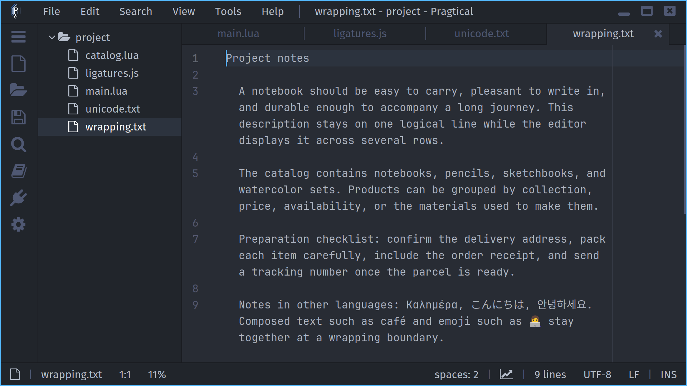
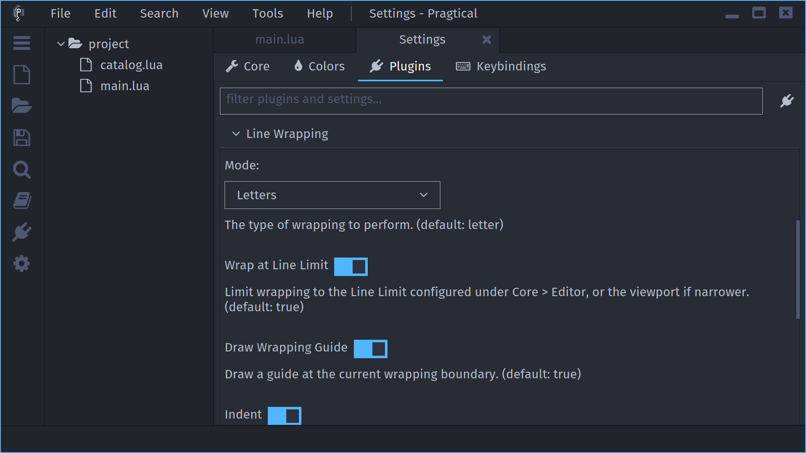

import Tabs from '@theme/Tabs';
import TabItem from '@theme/TabItem';

# Line Wrapping

Soft wrapping displays a long document line on several screen rows without
inserting newlines into the file. Toggle wrapping for the active document
with <kbd>F10</kbd>, **View > Word Wrap**, or `line-wrapping:toggle`.



## Choose a Boundary

**Wrap at Line Limit** is enabled by default. Wrapped views use the smaller
of the editor's **Line Limit** and the available viewport width. The default
column limit is 80. The column boundary is measured using the code font;
the text still wraps earlier when the window is narrower.

Disable **Wrap at Line Limit** to wrap only at the available viewport width.
The Line Guide plugin and wrapping guide are separate controls: the first
marks the configured column limit; the second marks the actual wrap boundary.

<Tabs groupId="configuration">
  <TabItem value="user-module" label="User Module" default>

```lua
local config = require "core.config"
config.line_limit = 80
config.plugins.linewrapping = {
  mode = "word",
  wrap_at_line_limit = true,
  indent = true,
  guide = true,
}
```

  </TabItem>
  <TabItem value="settings-ui" label="Settings UI">

Open **Settings > Plugins > Line Wrapping**. Choose the wrapping mode and
adjust **Wrap at Line Limit**, **Draw Wrapping Guide**, and continuation
indentation. Set the shared **Line Limit** under **Core > Editor**. Searching
Settings for `wrap_at_line_limit` or `line limit` finds those controls directly.



  </TabItem>
</Tabs>

## Word and Letter Modes

`word` prefers whitespace breaks and keeps leading indentation with the first
word. A word that cannot fit a continuation row is split so it remains visible.
`letter` wraps at displayed-character boundaries. Both modes keep combining
marks and emoji sequences together and respect syntax-specific font widths.

With **Indent** enabled, continuation rows preserve the original line's
indentation. Moving vertically, selecting with the mouse, searching, and
folding continue to follow the displayed rows. The file's logical line numbers
do not change.

An optional `config.plugins.linewrapping.width_override` can be a pixel width
or a function receiving the DocView. It takes precedence over automatic
viewport/column sizing and is intended for custom layouts.

The [Diff Viewer](diff-viewer.md) also supports wrapping while keeping both
sides aligned. For plugin interfaces, see the
[Line Wrapping API](/docs/api/plugins.linewrapping).
