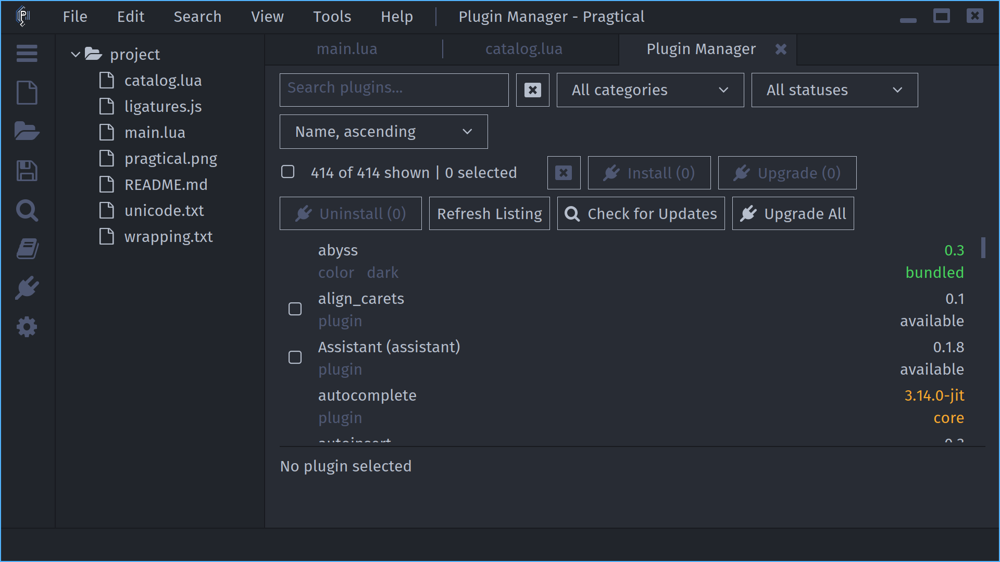

# Plugins

Pragtical implements many features as plugins. By default, official releases
bundle all language and color plugins for convenience.

Extra plugins can be found on the github [plugins repository] or this website
[Plugins] section, which implements a convenient graphical interface to the
plugins repository.

:::note These plugins are contributed by the community.
:::

## Plugin Manuals

The [Plugins documentation](/docs/category/plugins) section contains
workflow guides for individual plugins. Start with the
[Source Control Management manual](../plugins/scm/index.md) for Git and Fossil
integration, including changes review, commits, branches, and synchronization.

The [Language Server Protocol manual](../plugins/lsp/index.md) covers
language-server setup, completion, navigation, diagnostics, and refactoring.

## Location

### Bundled Plugins

Plugins that come bundled with Pragtical are usually stored in
`DATADIR/plugins`.

On macOS, `DATADIR` is always the application resources directory.

On other platforms, Pragtical checks whether the program
is installed according to Unix Filesystem Hierarchy Standard.
If that is true,
then `DATADIR` will be `<path-to-exe>/../share/pragtical`.

Otherwise, `DATADIR` will be `<path-to-exe>/data`.

### User Plugins

User plugins should be installed into `USERDIR/plugins`.

On Linux, `USERDIR` uses the XDG Base Directory Specification. Pragtical first
checks the `$XDG_CONFIG_HOME` environment variable and falls back to
`~/.config` otherwise.

## Plugin managers

Use [ppm] to install, update, and remove plugins, themes, and libraries.
It is the supported plugin manager for Pragtical.

### PPM

[ppm] is more akin to distro package managers such as `apt` and `dnf`.

PPM is already included in official Pragtical builds, so you do not need to
install it separately. Run the bundled command-line manager with `pragtical pm`;
this does not require a standalone `ppm` command on your `PATH`.

A GUI for installing plugins is available from **Tools > Plugin Manager**,
the toolbar, and the `Plugin Manager` commands in the command palette.



To enable or disable an installed plugin, use **Settings > Plugins > Installed**.
The search field also filters this list. Restart the editor after changing
which plugins should load.

## Installing plugins

To install a plugin, simply drag the related plugin file into
`USERDIR/plugins`.

:::caution For plugins that comes in a folder, please consult specific instructions for each plugin.
Historically, Pragtical does not enforce a specific file structure for these
types of plugins. Old plugins may not have a `init.lua` file, which is used by
Lua to find a plugin. In this case, you need to follow their install instructions.
:::

To install a plugin with ppm, use `ppm plugin install`.
For example, to install lsp, run:

```bash
ppm plugin install lsp
# Or use the editor's CLI:
pragtical pm plugin install lsp
```

This will install/update the lsp plugin.

To install themes or libraries, you can use
`ppm color install` and `ppm library install` respectively.

## Updating plugins

To update a plugin, you'll need to re-download them.
For plugins hosted as separate git repositories, you can simply
pull new updates.

If you have a plugin manager installed, updating plugins should
be easier.

To update plugins with ppm, run `ppm upgrade`.

```bash
ppm upgrade
# Or use the editor's CLI:
pragtical pm upgrade
```

This will update all the plugins to their latest versions.

## Uninstalling plugins

To remove a plugin, simply delete the associated file/directory.

To uninstall a plugin, run `ppm plugin uninstall`.
For instance, to uninstall lsp, run:

```bash
ppm plugin uninstall lsp
# Or use the editor's CLI:
pragtical pm plugin uninstall lsp
```

Uninstalling themes and libraries can be done with
`ppm color uninstall` and `ppm library uninstall` respectively.

## Troubleshooting

### Plugin Manager Crash or Failure

Most of the time this happens after updating to a newer plugin manager version
and using old state data, common symptom is failing to download plugins.
To fix you can try the following steps:

1. Close any open editor instances.
2. Remove the plugin manager state directory `rm -rf ~/.config/pragtical/ppm`
   (on windows the directory is in `C:\Users\YourUserName\.config\pragtical\ppm`).
3. Re-open the editor, launch the plugin manager and try again.
4. If this doesn't solves the problem open a [plugin manager issue].

### PPM Installed from Scoop Fails to Install Plugins

If you installed `ppm` and `pragtical` from Scoop and receive an error message
when trying to install plugins, such as `can't find dependency`, it indicates
that `ppm` was unable to locate the installation data files for `pragtical`.

Scoop adds the following directories to the environment variable `PATH`:

* `C:\ProgramData\scoop\shims` (for globally installed apps)
* `C:\Users\<YourUsername>\scoop\shims` (for user-installed apps)

It installs wrapper executables in these directories that redirect to the
actual application installation paths, which can be:

* `C:\ProgramData\scoop\apps\pragtical\current` (globally installed)
* `C:\Users\<YourUsername>\scoop\apps\pragtical\current` (user installed)

This strategy of using redirector executable wrappers can cause the plugin
manager to fail when searching for the data files. The `pragtical.exe`
redirector binary located in `C:\ProgramData\scoop\shims` or
`C:\Users\<YourUsername>\scoop\shims` does not reside alongside the core Lua
runtime files.

To successfully install plugins that have explicit dependencies on core plugins,
you can use the `--datadir` option to specify the installation path of
`pragtical` data files. For example, to install `lsp_quicklintjs`, which depends
on the core plugin `language_js`, you can run:

```sh
ppm install lsp_quicklintjs --datadir='C:\ProgramData\scoop\apps\pragtical\current\data'
```

Another workaround is to prepend `C:\ProgramData\scoop\apps\pragtical\current`
or `C:\Users\<YourUsername>\scoop\apps\pragtical\current` to the PATH environment
variable. This allows the plugin manager to properly locate the data directory,
so you won't need to specify `--datadir` each time you call `ppm`.

[plugin manager issue]: https://github.com/pragtical/plugin-manager
[plugins repository]: https://github.com/pragtical/plugins
[Plugins]:            /plugins
[ppm]:                https://github.com/pragtical/plugin-manager
