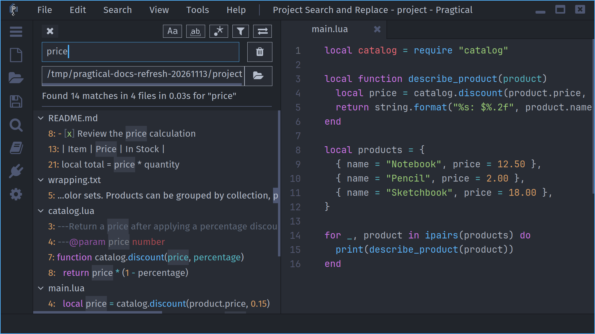
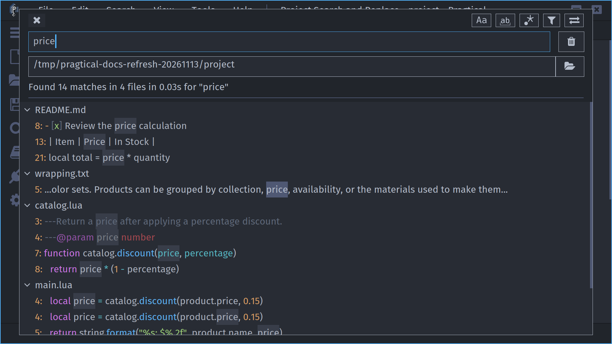

# Project Search

Press <kbd>Ctrl</kbd>+<kbd>Shift</kbd>+<kbd>F</kbd> to open the reusable project
search view. With no explicit path, it searches the open project directories.
Choose a directory in the path field to restrict the scope.



## Search and Replace

Enter text and start the search. The search controls support case-insensitive
matching, whole words and regular expressions. Global project search supports
plain text and regex; the document search bar also supports Lua patterns.

Expand the filters to include or exclude paths. Expand replacement to enter
replacement text, then check the files or matches you want to replace. Review
the selected results before applying a project-wide replacement.

Use the arrow keys to navigate the results, <kbd>Enter</kbd> to open a match,
and <kbd>Space</kbd> to toggle the selected replacement checkbox. A result's
context menu includes normal and split opening actions. Ctrl-click opens a
match in the configured split direction, reusing that result pane while its
source layout remains available.

## Position the Results

**Settings > Plugins > Project Search > Position** offers **Left**, **Right**
and **Center**. Left is the default. The centered popup keeps keyboard result
navigation and remains available while live searches update the results.
Its opening and closing follow the normal transition settings.



**Live Search** starts searches while typing and is optional. Other settings
control worker count, syntax highlighting and the result split direction.

## Plugin Interfaces

Plugins can configure and open the global search with an options table:

```lua
local projectsearch = require "plugins.projectsearch"
local results = projectsearch.show {
  text = "TODO",
  search_type = "plain",
  insensitive = true,
  run = true,
}
```

`show` and `toggle` return the reusable global ResultsView. `hide` returns it
if it has already been created, or `nil` otherwise, and applies supplied
options without starting a search.
See the [Project Search API](/docs/api/plugins.projectsearch) for all options,
including explicit paths, filters, replacement and focus behavior.
