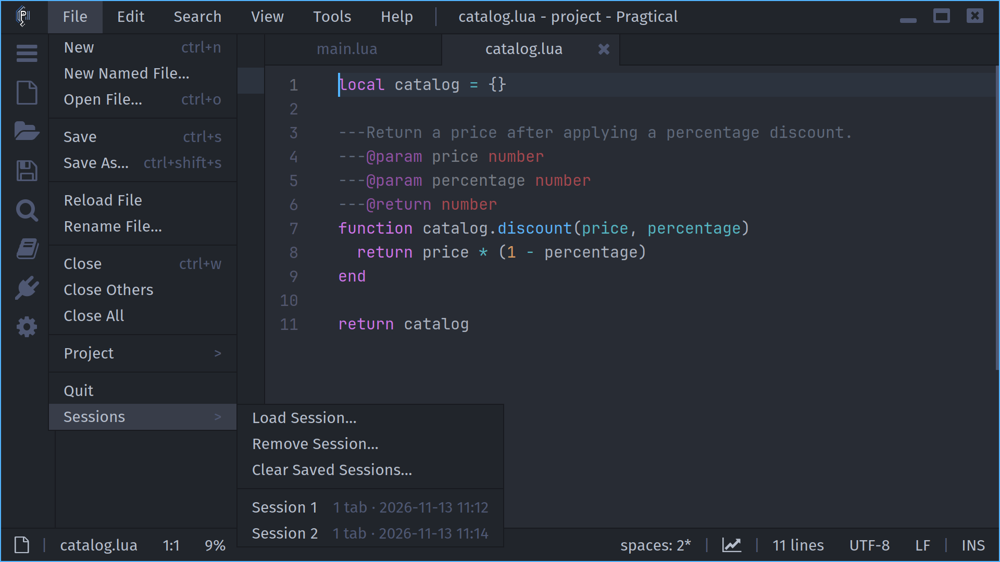

import Tabs from '@theme/Tabs';
import TabItem from '@theme/TabItem';

# Workspace Sessions

The Workspace plugin remembers a project's open documents, split layout,
active tab, view state, and added project directories. Each project has a
**Main Session** and can have additional named sessions for different tasks.
The active session is saved when you exit or change projects and restored
when you return.



Workspace saves include unsaved text in existing files and untitled documents.
They do **not** save those edits to the document files. Review restored edits
before saving them normally.

## Save a Session

Open **File > Sessions**:

- **Save Session** updates the active session immediately.
- **Save Session As** saves the current layout and buffers under a name and
  makes that session active.

For example, keep your usual layout in Main Session, then use Save Session As
to create a separate **Feature work** session. Later saves and normal exits
update Feature work, leaving the saved Main Session available to load again.
Using an existing name replaces that named session's saved state.

Session names must contain non-whitespace text and cannot contain control
characters. Very long names may be rejected, particularly when their encoded
filenames exceed the filesystem-safe limit.

## Choose a Saved Session

Open **File > Sessions** to see saved sessions for the current root project.
Main Session appears first, followed by named sessions in alphabetical order.
A checkmark identifies the active session. Choose a session directly, or select
**Load Session** to search the list. The prompt shows **Active** beside the
current session and includes save times.

Before switching, the current workspace is saved to its active session. The
chosen session replaces the document layout and becomes active; loading does
not delete its saved file. If the backup or restoration fails, the current
layout and selection are retained. Locked panels stay attached while the
document layout is restored.

Normal startup returns to the last active session, or Main Session if that
named session no longer exists. Opening explicit files on startup skips
automatic workspace restoration; you can still load a session manually.

## Recover Unsaved Work

Optional periodic saving keeps a temporary recovery snapshot of the project's
layout and unsaved buffers. It is disabled by default. When enabled, it saves
changed workspace state every **10 seconds** by default, without writing the
document files or replacing the active session's regular save.

Each project has one recovery snapshot, reused rather than accumulated into a
history. It records which session the work belongs to. On normal project
restoration, an available recovery snapshot takes precedence over the regular
session save. You can also choose **File > Sessions > Recover Session** to
restore it manually.

Recovery restores unsaved edits as buffers, not as saved changes on disk.
A successful regular session save clears the temporary recovery snapshot.
Periodic saving cannot recover edits made after its latest snapshot, so save
important work normally rather than relying on it as a backup system.

### Configuration

<Tabs groupId="configuration">
  <TabItem value="user-module" label="User Module" default>

Enable periodic recovery in your user module:

```lua
local config = require "core.config"

config.plugins.workspace.autosave = true
config.plugins.workspace.autosave_interval = 10 -- Seconds; minimum 1.
```

Set `autosave` to `false` to disable periodic snapshots. Saving on exit,
project changes, and through the session commands still works.

  </TabItem>
  <TabItem value="settings-ui" label="Settings UI">

Open Settings, select **Plugins**, and expand **Workspace**. Enable
**Periodically Save Workspace** and adjust **Save Interval** in seconds.
Changes apply without restarting the editor.


  </TabItem>
</Tabs>

Workspace recovery is separate from the optional Autosave plugin that saves
document files. Enabling one does not enable the other.

## Remove Saved Sessions

**Remove Session** lets you choose one saved session to delete after
confirmation. Removing the active named session returns the active selection
to Main Session and clears its recovery data without closing your current tabs.

**Clear Saved Sessions** removes this project's saved sessions and recovery
snapshot after confirmation. Neither action closes the currently open tabs,
saves document files, or removes sessions belonging to another project.
Saving on exit remains enabled, so a session can be created again from the
still-open workspace.

## Commands

Press <kbd>ctrl+shift+p</kbd> to find these commands, or use **File > Sessions**.

| Command | Action |
| --- | --- |
| `workspace:save-session` | Update the active session. |
| `workspace:save-session-as` | Save a named session and activate it. |
| `workspace:load-session` | Choose a saved session to load and activate. |
| `workspace:recover-session` | Restore the project's temporary recovery snapshot. |
| `workspace:remove-session` | Choose a saved session to remove. |
| `workspace:clear-sessions` | Confirm removal of this project's saved sessions and recovery data. |

## Storage and Project Matching

Added project directories are stored as absolute paths, so restoration does
not depend on the directory from which the editor was launched. Missing
directories are skipped with a warning. Sessions belong to the root project's
full path, so projects with the same folder name do not share a session.

Session files live under `storage/ws/<project-name>-<path-hash>/` in the user
directory. This directory contains `main`, optional `session-<encoded-name>`
files, and a temporary `recovery` file when needed. Older session files are
migrated automatically. Multiple editor windows for the same root project
share these files; they do not have independent per-window recovery histories.

Sessions are local user state, separate from trusted project configuration
and from a plugin's optional
[project storage](../developer-guide/writing-plugins/persistent-state.md).
For plugin integration, see the [Workspace API](/docs/api/plugins.workspace).
